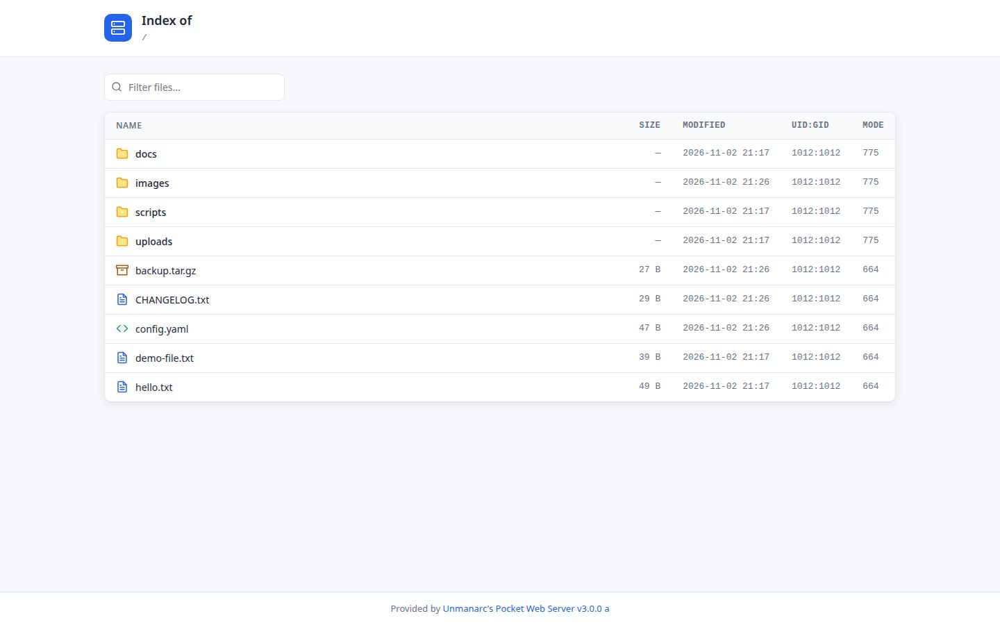
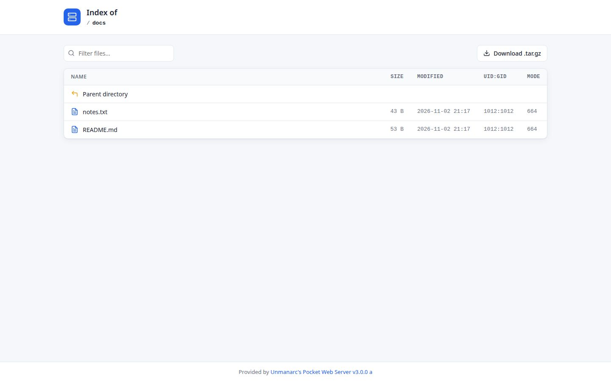
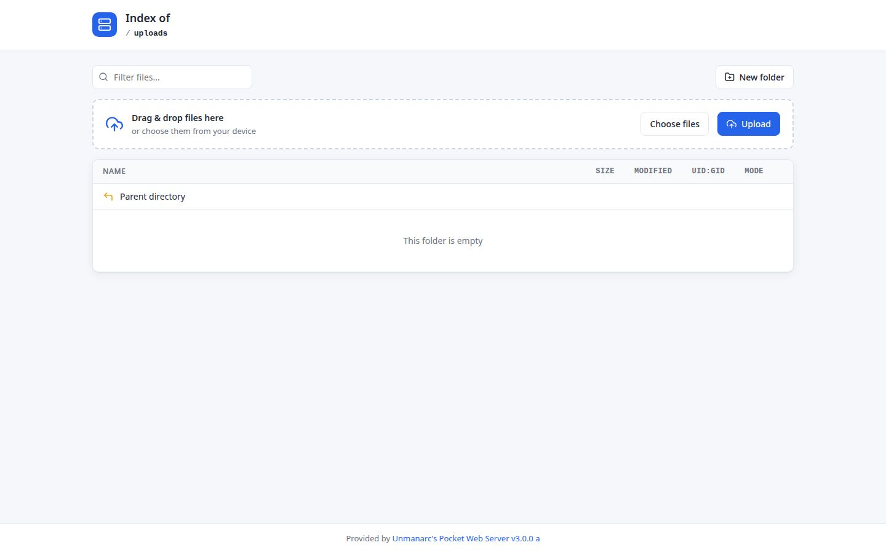

# uPocketWS

**Unmanarc's Pocket Web Server — the Swiss Army knife for serving a directory over HTTP.**

A single small binary that turns any folder into a browsable web share: password
protected, TLS capable, able to stream folders as `tar.gz` on the fly, to run
CGI-like executables and to receive uploads — with a modern, self-contained web UI.

[](https://copr.fedorainfracloud.org/coprs/amizrachi/unmanarc/package/uPocketWS/)
[](https://www.gnu.org/licenses/agpl-3.0)


---

## Documentation

| Document | Contents |
| --- | --- |
| [`INSTALL.md`](INSTALL.md) | Prebuilt COPR packages, Debian/Ubuntu notes, command line reference, systemd service and security considerations. |
| [`BUILD.md`](BUILD.md) | Prerequisites, building from source, optional TLS support, per-distribution toolchains and shrinking the binary. |
| [`CONTRIBUTING.md`](CONTRIBUTING.md) | Scope rules, coding conventions, pull request and security checklists, packaging notes. |
| [`docs/DEMO.md`](docs/DEMO.md) | How the screenshots below were produced. |
| [`LICENSE`](LICENSE) | The full text of the AGPL-3.0 license. |

---

## Screenshots

**Directory index** — files and folders with per-type icons, sizes, timestamps,
UID/GID, permissions and a live filter box:



**Sub-directory navigation** — breadcrumbs derived from the URL, sortable listing,
`Parent directory` shortcut:



**Uploads, new folders and drag & drop** — only enabled where the server was
started with the matching allow-list options:



---

## Features

- **Zero configuration file** — everything is a command line switch, defaults are sane.
- **Password protected access** via a simple two-line `--passfile` (user / password).
- **TLS (HTTPS) support** with X.509 certificate, private key and optional CA for
  client authentication (build with `-DWITH_SSL_SUPPORT=ON`).
- **On-the-fly `tar.gz`** of any allowed directory — perfect for pulling backups
  without staging a temporary archive.
- **CGI-like execution** — every executable file inside an allowed directory can be
  called and its output is served (Unix: exec bit; Windows: `.exe`/`.bat`).
- **Uploads, overwrite, delete and mkdir** — each capability restricted to explicit,
  repeatable, per-directory allow-lists with optional filename regex.
- **Modern responsive web UI** — breadcrumbs, filter, file-type icons, drag & drop
  uploads, clean light theme, embedded favicon (no external assets).
- **Tiny footprint** — C++17, multithreaded acceptor, no CGI shell, no PHP, no runtime
  dependencies beyond the stack in [`BUILD.md`](BUILD.md). Strips/compresses down to
  roughly **200 KB**.
- **systemd friendly** — `--sys` for journald output plus a built-in
  `--install/--reinstall/--uninstall` service helper.

### Use cases

- Publishing an ISO/package repository on a LAN.
- Grabbing a folder as a compressed archive straight from a browser.
- Sending/receiving files between machines without configuring Samba/NFS/SSH.
- Exposing a script's output over HTTP in a couple of seconds.
- Quickly looking inside a container or appliance image (it runs anywhere).

---

## Quick start

Fastest path on Fedora / RHEL / CentOS / Rocky / AlmaLinux — see
[`INSTALL.md`](INSTALL.md) for the per-distribution commands:

```bash
dnf copr enable amizrachi/unmanarc -y
dnf -y install uPocketWS
```

From source (Debian, Ubuntu or a custom prefix) — details in [`BUILD.md`](BUILD.md):

```bash
git clone https://github.com/unmanarc/uPocketWS
cd uPocketWS
cmake -DCMAKE_BUILD_TYPE=MinSizeRel -DCMAKE_INSTALL_PREFIX:PATH=/opt/osslibs \
      -DEXTRAPREFIX:PATH=/opt/osslibs -B../uPocketWS-build .
cmake --build ../uPocketWS-build -j"$(nproc)"
cmake --install ../uPocketWS-build
```

Then serve the current directory on the default port `8001`:

```bash
uPocketWS
```

Open <http://localhost:8001/>. A more complete example with authentication,
archive download and a writable `incoming` directory:

```bash
uPocketWS \
  -r /srv/files \
  -l 8080 \
  -p /etc/uPocketWS/users.conf \
  -g downloads \
  -u incoming -o incoming -d incoming -m incoming -n '^[A-Za-z0-9._-]+$'
```

The full flag reference, the systemd recipes and the security checklist live in
[`INSTALL.md`](INSTALL.md).

---

## Compatibility

Regularly tested on:

- Fedora Linux (33 and newer)
- RHEL / CentOS / Rocky / AlmaLinux 7, 8, 9 and **10**
- Ubuntu 20.04 LTS (Server) through **26.04 LTS**
- Debian 11 through 13

The source also carries the Windows code paths (`_WIN32` guards in `src/main.cpp`
plus a `WIN32` link configuration in `CMakeLists.txt`), but Windows is not part of
the regular test matrix. Toolchain versions per distribution are listed in
[`BUILD.md`](BUILD.md#distribution-notes).

---

## Contributing

Bug reports and pull requests are welcome. Read [`CONTRIBUTING.md`](CONTRIBUTING.md)
for the scope rules, coding conventions and the security checklist every patch has
to pass, then use the issue templates and the pull request template under
`.github/`. Keep changes scoped: this project favors small, dependency-free C++.

## License

Distributed under the **GNU Affero General Public License v3.0**. See the
[`LICENSE`](LICENSE) file for the full text.

Author: Aarón Mizrachi <aaron@unmanarc.com>
